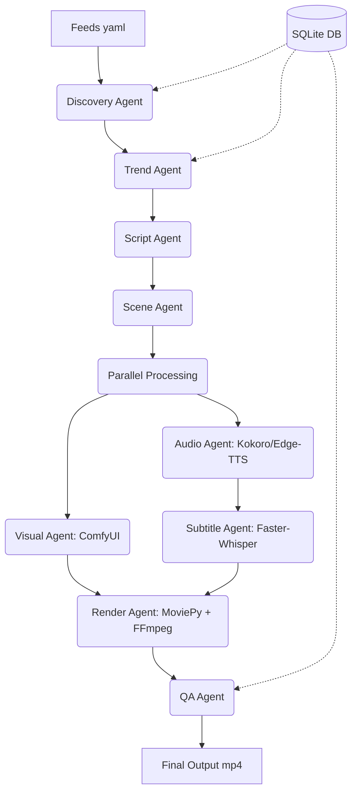

# Content Factory

A local-first, zero-cost, modular AI content generation system capable of producing viral vertical shorts automatically.

## Architecture Diagram



## Workflow Diagram

1. **Discovery**: RSS feeds deduplicated via SQLite -> `story_candidates.json`
2. **Trend**: LLM ranks stories for virality -> `selected_story.json`
3. **Script**: LLM generates strict schema JSON -> `script.json`
4. **Scene**: LLM plans consistent cinematography -> `scene_plan.json`
5. **Parallel**: 
   - Audio TTS -> `final_audio.mp3`
   - ComfyUI Image Gen with Asset Reuse -> `visual_manifest.json`
6. **Subtitle**: Whisper transcribes word timings -> `captions.ass`
7. **Render**: MoviePy timeline composition + FFmpeg subtitle burn.
8. **QA**: Validate dimensions, length, audio sync, and missing files.

## Installation Guide

### Prerequisites
- Windows 11
- Python 3.12
- Local LLM Runner (e.g. Ollama)
- Local Image Gen (e.g. ComfyUI)
- FFmpeg (added to PATH)

### Setup
1. Clone this repository.
2. Install dependencies:
   ```bash
   pip install -r requirements.txt
   ```
3. Initialize a niche:
   Create `niches/my_niche/feeds.yaml` containing your RSS feeds.

## Local Deployment Guide
1. Start Ollama: `ollama serve` (Ensure `llama3` and `mistral` are pulled).
2. Start ComfyUI on `127.0.0.1:8188`.
3. Adjust `configs/config.yaml` to point to your desired models.

## User Guide
Run the system by passing your target niche to the main script:
```bash
python main.py tech_news
```
Check `runs/` directory for your generated videos and metrics!

## Developer Guide
- **Adding Plugins**: Create a new class in `plugins/` and instantiate it within the respective agent.
- **Modifying State**: Edit `core/state_machine.py`. All check-pointing automatically saves to SQLite.
- **Asset Reuse**: `agents/visual_agent.py` hashes prompts. If a hash exists in `asset_library/`, generation is skipped.

## Troubleshooting Guide
- **FFmpeg Error**: Ensure FFmpeg is installed and added to Windows PATH variables.
- **OOM (Out of Memory)**: Ensure `max_concurrent_gpu_tasks` in `config.yaml` is set to 1 if Ollama and ComfyUI compete for VRAM.
- **JSON Decode Error**: Ensure Ollama is running a capable instruction model (like `llama3`) and json mode is fully supported.
